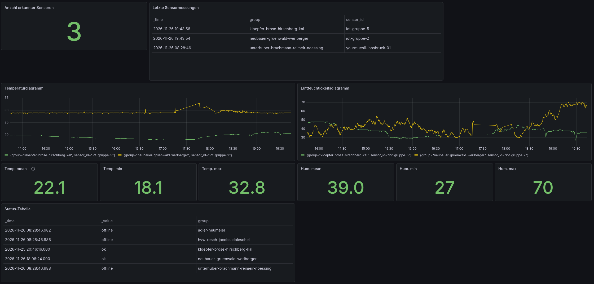

## Komponenten und Datenfluss

Der MQTT-Broker wird **extern** betrieben; die [Compose-Datei](../src/iiot_monitoring/docker-compose.yml) startet keinen Broker.

```{mermaid}
flowchart TD
    Device["Gerät"] -->|MQTT veröffentlichen| Broker["Externer MQTT-Broker"]
    subgraph Stack["Docker-Compose-Stack"]
        Collector["Collector"] -->|HTTP: schreiben| Influx["InfluxDB 2"]
        Influx -->|Abfrageergebnisse| Grafana["Grafana"]
    end
    Broker -->|MQTT zustellen| Collector
```

- **Collector:** Der [MQTT-Client](../src/iiot_monitoring/mqtt_collector.py) abonniert und prüft Nachrichten; der [Writer](../src/iiot_monitoring/influx_writer.py) speichert gültige Daten.
- **InfluxDB:** Speichert Messwerte und Gruppenstatus dauerhaft als Zeitreihen.
- **Grafana:** Fragt InfluxDB ab und zeigt die Daten im automatisch bereitgestellten [Dashboard](../src/iiot_monitoring/grafana/dashboards/sensor_data.json); die [Datenquelle](../src/iiot_monitoring/grafana/provisioning/datasources/influxdb.yaml) ist vorkonfiguriert.

Im Compose-Netz erreichen Collector und Grafana InfluxDB über `http://influxdb:8086`. Grafana stellt die Abfragen; der Pfeil zeigt die Richtung der zurückgegebenen Daten.

## Start und Zugriff

Voraussetzungen: Docker mit Compose sowie Netzwerkzugang und Zugangsdaten für den externen Broker. Im Repository-Stammverzeichnis:

```sh
cd src/iiot_monitoring
cp .env.example .env
```

Bearbeite `.env` vor dem Start und ersetze die Platzhalter:

- `MQTT_HOST`, `MQTT_PORT`, `MQTT_USER`, `MQTT_PASSWORD`: Broker-Adresse und Zugangsdaten. Die Adresse muss **vom Container** erreichbar sein; `localhost` bezeichnet dort den Container selbst.
- `INFLUX_USER`, `INFLUX_PASSWORD`, `INFLUX_TOKEN` sowie `GRAFANA_USER`, `GRAFANA_PASSWORD`: sichere Zugangsdaten setzen.
- `INFLUX_ORG` und `INFLUX_BUCKET`: Organisation und Bucket festlegen. Für das mitgelieferte Dashboard den Bucket `sensor_data` beibehalten; seine Abfragen verwenden diesen Namen fest.

```sh
docker compose config --quiet
docker compose up -d --build
docker compose ps
docker compose logs --tail=100 collector
```

Öffne auf dem Docker-Host <http://localhost:3000>, melde dich mit `GRAFANA_USER` und `GRAFANA_PASSWORD` an und wähle **Dashboards → IIoT Monitoring → Sensor_Data**. InfluxDB ist lokal unter <http://127.0.0.1:8086> erreichbar. Bei leeren Panels Zeitraum, Collector-Logs, Broker-Zugang, Topics und Bucket prüfen.


## Daten und Betriebshinweise

- Der Collector abonniert `iiot/group/+/sensor/+/state` und `iiot/group/+/status`. Er verarbeitet Temperatur, Feuchtigkeit und Gruppenstatus mit MQTT QoS 0, ohne lokale Warteschlange.
- Das MQTT-Feld `simulated` wird **nicht gespeichert**: Grafana unterscheidet simulierte Feuchtewerte nicht von Messwerten.
- MQTT läuft ohne TLS; verwende ein vertrauenswürdiges Netzwerk oder einen abgesicherten Tunnel. `.env` und Zugangsdaten geheim halten. Grafana und InfluxDB sind nur lokal erreichbar.
- Die Volumes bleiben bei `docker compose down` erhalten; `docker compose down -v` **löscht** sie samt Daten und Einstellungen. Änderungen an `.env` aktualisieren bestehende Zugangsdaten nicht automatisch.


## Grafana-Screenshot


